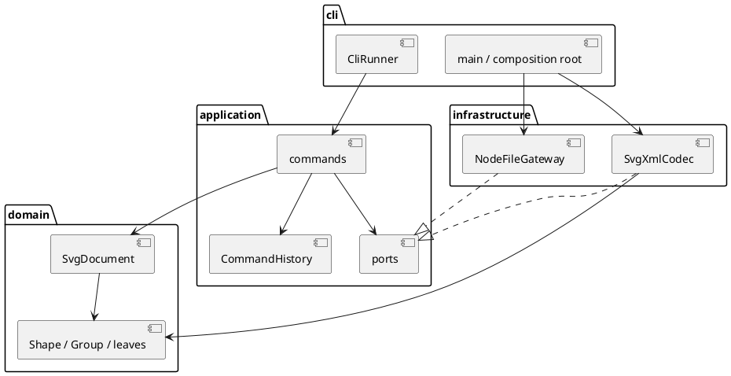

# Lab1 Phase 1：SVG 编辑器

## 架构方案

### 模块划分

| 目录 | 职责 |
| --- | --- |
| `src/domain/` | 图形、多态几何操作、Composite 树、文档不变量；无 IO |
| `src/application/` | 用例、Command、历史事务、端口、命令解析与文本展示 |
| `src/infrastructure/` | SVG XML 编解码、文件系统适配器 |
| `src/cli/` | 组合根、逐行 REPL 与标准输入输出 |
| `test/` | 行为、读写、历史、CLI 集成测试 |
| `examples/` | 可回放命令与 SVG 样例 |

### 设计模式的选择

- **Command（必选）**：一条命令一个类；编辑命令走同一历史入口。
- **Composite**：`Group` 与叶子继承 `Shape`，移动、缩放、属性及克隆采用多态。
- **Memento**：编辑在文档副本上运行，成功才提交 before/after 快照；失败无副作用。
- **Factory / Registry**：图形构造与命令分发各一个注册表。
- **Ports & Adapters**：XML 和磁盘通过端口接入，可用内存文件替身测试。

按名字分派只在命令注册表与图形工厂；两处均标为后续插件阶段的待重构点。Phase 1 不实现 box 或动态插件加载。

### 依赖方向规则

1. domain 不依赖其他业务层，也不依赖 Node、XML 库。
2. application 只依赖 domain 与本层端口，不导入 infrastructure / cli。
3. infrastructure 可以依赖 application 的端口和 domain，不依赖 cli。
4. cli 为组合根，可依赖以上各层；测试可跨层验证。

原因：图形规则保持独立，CLI 或文件格式变化不会污染模型。

### 变化点假设

1. 新图形：保留 Shape 多态及工厂注册点；六种图形不靠 tag switch 操作。
2. 新命令 / 新 UI：命令对象可复用，REPL 不持有业务规则。
3. 新文件来源：以端口替换磁盘适配器。
4. 插件：只保留注册入口；动态加载、box 复合语义留到后续阶段。
5. 大文档历史内存：当前采用深拷贝保证失败原子性；差量撤销暂不实现。

## 过程记录

- 第 1 步：从任务说明提取范围，先写模块依赖、扩展点与提交骨架。
- 后续实现和验证结果将在各次实际提交中追加，不虚构人工讨论或测试结果。

## 一致性自查

待实现完成后核对目录、类文件及依赖检查结果。

## 质量保证手段

计划采用严格 TypeScript 编译、行为测试、SVG round-trip、真实 CLI 子进程测试及依赖扫描；最终记录真实执行结果。
