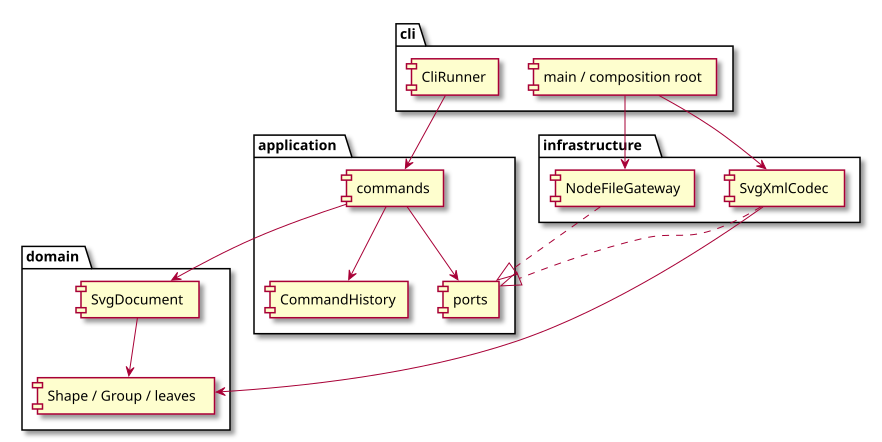
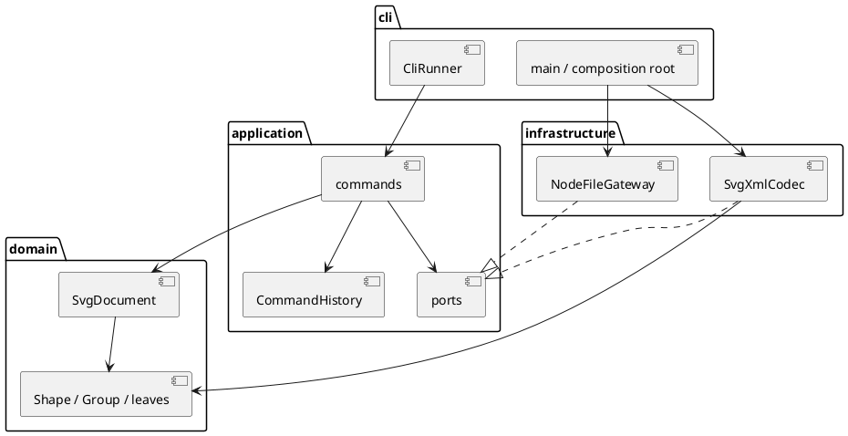

# Lab1 Phase 1：SVG 编辑器

## 架构方案

### 模块划分

| 目录 | 职责 |
| --- | --- |
| `src/domain/` | 图形、多态几何操作、Composite 树、文档不变量；无 IO |
| `src/application/` | 用例、Command、历史事务、端口、命令解析与文本展示 |
| `src/infrastructure/` | SVG XML 编解码、文件系统适配器 |
| `src/cli/` | 组合根、逐行 REPL 与标准输入输出 |
| `test/` | 行为、读写、历史、CLI 集成测试 |
| `examples/` | 可回放命令与 SVG 样例 |
| `scripts/` | 用 TypeScript AST 检查依赖方向和类文件约定 |

源文件：[architecture.puml](architecture.puml)。以下内嵌同一图的定义，方便支持 PlantUML 的阅读器直接渲染。

### 设计模式的选择

- **Command（必选）**：一条命令一个类；编辑命令走同一历史入口。
- **Composite**：`Group` 与叶子继承 `Shape`，移动、缩放、属性及克隆采用多态。
- **Memento**：编辑在文档副本上运行，成功才提交 before/after 快照；失败无副作用。
- **Factory / Registry**：图形构造与命令分发各一个注册表。
- **Ports & Adapters**：XML 和磁盘通过端口接入，可用内存文件替身测试。

具体落点：`CommandRegistry` 根据名字创建 `Command`，每个命令类实现 `execute(context)`；`EditingCommand` 统一把编辑提交给 `CommandHistory`，子类的 `apply(document)` 只关心该用例。`HistoryEntry` 封装 before/after 文档，不把内部快照暴露给外部；undo/redo 由历史条目恢复副本，不要求每种命令各写一套反向算法。

`Shape` 封装 id、展示属性与公共白名单；`GeometricShape` 封装几何数值及约束；Rect/Circle/Ellipse/Line/TextShape 实现各自的移动与克隆。`Group` 持有私有成员列表，通过同一个 Shape 接口递归操作；业务命令无需辨别 rect/circle/g。`SvgDocument` 负责全局唯一 id、父子关系、循环与顺序规则。

编辑事务顺序为：读取当前文档 → 深拷贝工作文档 → 命令应用到副本 → 制作历史快照 → 提交文档并清空 redo。任何一步的校验或数值异常均发生在提交前。例如一组中第一个矩形已缩放、第二个圆因数值溢出失败，当前文档中的两者都不变。文件操作同样先完成读取解析/写入，再更新会话路径并设置历史屏障。

按名字分派只在命令注册表与图形工厂；两处均标为后续插件阶段的待重构点。Phase 1 不实现 box 或动态插件加载。

| 分派位置 | 当前形式 | 后续待重构 |
| --- | --- | --- |
| `application/CommandRegistry.ts` | command name → 构造命令对象 | 将内置注册清单提取为可注入注册入口 |
| `domain/ShapeFactory.ts` | shape type → ShapeProvider | 将内置 provider 的装配移到组合根，增加外部插件发现机制 |

属性白名单和 XML 语法解析仅处理属性/语法约束，不按图形类型分派。没有 tag switch 或按图形类型分支执行 move/scale/set/delete 的代码。

### 依赖方向规则

1. domain 不依赖其他业务层，也不依赖 Node、XML 库。
2. application 只依赖 domain 与本层端口，不导入 infrastructure / cli。
3. infrastructure 可以依赖 application 的端口和 domain，不依赖 cli。
4. cli 为组合根，可依赖以上各层；测试可跨层验证。

原因：图形规则保持独立，CLI 或文件格式变化不会污染模型。

### 变化点假设

1. 新图形：保留 Shape 多态及工厂注册点；六种图形不靠 tag switch 操作。
2. 新命令 / 新 UI：命令对象可复用，REPL 不持有业务规则。
3. 新文件来源：以端口替换磁盘适配器。
4. 插件：只保留注册入口；动态加载、box 复合语义留到后续阶段。
5. 大文档历史内存：当前采用深拷贝保证失败原子性；差量撤销暂不实现。
6. 选择对象及跨父级分组策略：当前集中在 SvgDocument；本阶段无鼠标多选、坐标变换 UI 或复杂 CSS 重算，不引入相应框架。

### 规格中的未定细节与本次决策

| 未完全指定的细节 | 本次决策与理由 |
| --- | --- |
| group 收编来自不同父容器的元素时，新 g 放哪 | 放在最低公共父级，并占据最早选中分支的位置；原子移动后保持文档先序，行为可重复 |
| group 参数顺序和原有顺序冲突 | 采用原文档先序，遵守“保持相对顺序”；例如 `group pair b a` 仍保留原来的 a,b 顺序 |
| front/back 的“前/后” | 按 SVG 绘制语义，front 移到同级末尾，back 移到同级开头 |
| 保存与撤销反馈文本 | 正常编辑显示结果摘要；undo/redo 回显 `undone:` / `redone:` 加原摘要，语义一致且不伪称执行了反向数值计算 |
| 历史 IO 屏障 | 成功 init/read/save/canvas 修改尺寸清空双栈并禁用；失败 IO 和 canvas 查询均不设屏障 |
| 外部 SVG 变换 | 额外支持正数均匀 scale 与 translate 的基本组合；不支持的变换明确拒绝，不静默丢弃 |
| 未安装插件时的 data-kind | 保留标记但作为普通 g；不把所有 data-kind 都误判为不可解散复合图形 |

## 过程记录

以下为本次 AI 实施过程中实际发生的决策与验证记录，不冒充用户已经提出过的反馈。

| 迭代 | 观察 / 问题 | 确认与修改 |
| --- | --- | --- |
| 1. 规格与骨架 | 重点包括设计模式、代码依赖和 Git 过程；box 明确不属于 Phase 1 | 先提交架构、严格 TS 配置和依赖锁文件，六种内置类型以外一律报错 |
| 2. 图形模型 | 若业务命令按 tag 分支，很快违反范式要求；公开 children 数组容易破坏树不变量 | 改为 Shape 抽象类 + 叶子多态，Group 的私有成员通过插入/删除接口管理，返回列表副本 |
| 3. 撤销机制 | 手工反向 move/scale 无法覆盖 group/delete 的全部父级和顺序，浮点逆操作也可能漂移 | 采用 Command + Memento；一条编辑在副本上运行，前后快照构成一个历史单元 |
| 4. SVG 接口 | 严格编译发现 XML 库的 localName 可空，直接当字符串会违反类型约束 | 使用 `localName ?? tagName`；继续保持 DOM 依赖只在 infrastructure |
| 5. 自动 id | 边读边起名会与文件后面才出现的 rect1 冲突 | 先扫描全部显式 id，后分配缺失 id；添加前后冲突和根 id 测试 |
| 6. 首轮测试 | show 初版按 Map 插入顺序先输出样式，与示例几何优先的可读性不符 | 将属性明细分为几何/内容行和展示属性行，重新运行测试 |
| 7. round-trip 测试 | 第一次保存与读回再保存的根属性顺序不同，字节稳定性测试失败 | 根属性按 xmlns、width、height、viewBox 的固定顺序生成，再追加其他属性；测试通过 |
| 8. 复合类型边界 | 一度按 data-kind 拒绝解散所有 g，但未安装插件时应降级为普通 g | 删除误判，用 data-kind=box 外部 SVG 验证普通容器可操作 |
| 9. 一致性检查 | 原先只预留读入时的根 id，后续 create/group 仍可能重复使用它 | 将根 id 也加入 SvgDocument 的新增/分组冲突检查，并添加回归测试 |
| 10. 完整验证 | 单命令成功不足以证明历史完整性 | 114 条混合编辑全部撤销再重做，比较初始/最终 SVG；另用真实子进程和磁盘文件回放案例 |

Git 实际按骨架、domain、application、IO/REPL、测试与修正、交付文档分次提交；以 `git log --oneline --decorate` 为准。最初交付包时尚无远程账户/仓库信息，之后用户指定 `GentlemonsterJ/svg-editor-phase1` 并连接 GitHub，因此追加文档提交记录正式提交目标。最终版本标记为 `final`，远程上传以原始 Git 提交对象和标签核对为准；截止日期未提供，不声称已经符合未知的截止时间。

## 一致性自查

1. **模块划分是否一致？** 是。实际生产代码为 domain/application/infrastructure/cli 四层，与初始方案一致；追加 `scripts/` 仅用于架构检查，已列入上表。生产代码 57 个 TypeScript 文件，每个类与文件同名、一文件一类。接口可单独成文件；入口 main.ts 只装配并启动，不承载业务过程函数。
2. **依赖方向是否被违反？** 当前静态 import 检查未发现违规，共检查 168 处 import。抽样：MoveCommand → SvgDocument；SvgDocument → Shape/Group；SvgXmlCodec → SvgCodec 端口 + domain；main → EditorContext + 两个适配器。domain 不引用 Node 或 XML 库，application 不引用具体 IO。

架构检查使用 TypeScript AST，不靠简单文本搜索来判断注释里的词。检查静态依赖、类名文件名、多个类、顶层过程函数与 switch。它不能证明所有运行时行为正确，也不能自动证明“没有任何上帝类”，因此同时保留行为测试及人工阅读。

## 质量保证手段

验证环境为 Node.js 24.22.1、TypeScript 5.9.3；项目声明支持 Node.js >=22，未声称已在所有平台/版本逐一验证。

| 手段 | 实际结果 / 证据 |
| --- | --- |
| `npm run build` | strict、noUncheckedIndexedAccess、exactOptionalPropertyTypes 等检查通过 |
| `npm run check` | 36 项测试通过，0 失败；AST 架构检查通过 |
| `npm run test:coverage` | 生产代码行覆盖率 99.39%、分支 96.73%、函数 98.43%；不是正确性的充分证明 |
| 真实 CLI 子进程 | 回放 create/save/read/move/undo/redo，验证含空格路径、Unicode 文本、提示符与错误退出码 |
| 真实文件系统 | 临时文件写入后 rename；写失败验证原文件未被破坏且无残留临时文件 |
| 高层历史不变量 | 114 条混合编辑撤销回空文档，重做回最终状态；最终 SVG 再读回保持一致 |
| 导出样例 | flowchart/history 命令脚本生成对应 SVG，供浏览器直接预览 |

完整需求映射见 [ACCEPTANCE.md](ACCEPTANCE.md)。[validation.txt](validation.txt) 记录交付前测试和依赖检查输出。

已知取舍：历史保留完整深拷贝，内存随编辑次数与文档大小增长；文档查找目前用树遍历，适合实验规模，后续可增加 id 索引。SVG 支持基本子集及有限变换，超出范围明确失败。远程提交目标为 [GentlemonsterJ/svg-editor-phase1](https://github.com/GentlemonsterJ/svg-editor-phase1)；验收时应检查远程提交和 final 标签，本地包保留 Git 历史但不能代替远程提交。
